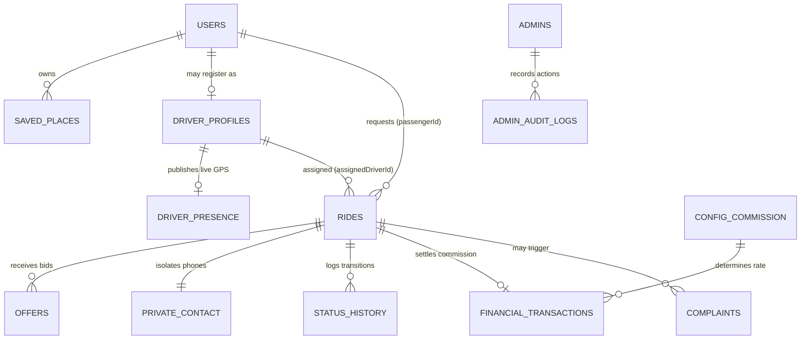

# D-RIDE Database Schema Documentation

**Database Engine:** Cloud Firestore (Enterprise Edition)  
**Named Database ID:** `ai-studio-android-dride-6be0d358-b89a-4405-9670-15d3d9f3ae39`  
**Launch Scope:** Dayrout (`dayrout`), Assiut Governorate, Egypt  
**Currency & Payment:** Egyptian Pound (`EGP`), `cash`  
**Source of Truth Files:** `firebase-blueprint.json`, `firestore.rules`, `app/src/main/java/com/example/data/model/FirestoreModels.kt`

---

## 1. Architecture & Entity Relationships

D-RIDE uses a **zero-trust, PII-isolated Cloud Firestore schema**. Sensitive fields (national IDs, document scans, and participant phone numbers) are isolated from public map/ride-discovery queries so drivers and passengers only see what they are authorized to access.



---

## 2. Collections & Subcollections Reference

### 2.1 `users/{userId}`
Private user accounts indexed by Firebase Auth UID (`Google Sign-In`).

| Field | Type | Required | Constraints / Allowed Values | Description |
| :--- | :--- | :--- | :--- | :--- |
| `userId` | `string` | Yes | Valid ID (`^[a-zA-Z0-9_\-]+$`), immutable | Firebase Auth UID (`== userId`) |
| `fullName` | `string` | Yes | `2..80` chars | User's display name |
| `phone` | `string` | No | `8..20` chars | Contact phone number |
| `email` | `string` | No | `<= 120` chars | Verified Google email |
| `photoBase64` | `string` | No | `<= 180,000` chars | Compressed profile avatar |
| `activeMode` | `string` | Yes | `passenger`, `driver`, `admin` | Last active app mode (`admin` reserved for admins) |
| `roles` | `array<string>` | Yes | `1..3` items from `passenger`, `driver`, `admin` | Assigned roles |
| `ratingAvg` | `number` | Yes | `0.0..5.0` | Average rating |
| `ratingCount` | `integer` | Yes | `>= 0` | Total number of ratings |
| `completedRidesCount` | `integer` | Yes | `>= 0` | Completed rides counter |
| `suspended` | `boolean` | Yes | Admin-controlled | Account suspension flag |
| `createdAt` | `timestamp` | Yes | Server timestamp (`<= request.time`), immutable | Creation time |
| `updatedAt` | `timestamp` | Yes | Server timestamp (`<= request.time`) | Last update time |

**Access Control:** Only owner or Admin can `get`; only Admin can `list`; owner cannot self-escalate to `admin` or alter `suspended`.

---

### 2.2 `users/{userId}/saved_places/{placeId}`
Cloud-synced favorite Dayrout locations (e.g., `home`, `work`) per user account.

| Field | Type | Required | Constraints / Allowed Values | Description |
| :--- | :--- | :--- | :--- | :--- |
| `userId` | `string` | Yes | `== userId`, immutable | Owner UID |
| `placeKey` | `string` | Yes | Valid ID (e.g., `home`, `work`) | Logical place key |
| `label` | `string` | Yes | `1..60` chars (e.g., `المنزل`, `العمل`) | Display label |
| `address` | `string` | Yes | `2..200` chars | Human-readable Dayrout address |
| `latitude` | `number` | Yes | `-90.0..90.0` | Latitude |
| `longitude` | `number` | Yes | `-180.0..180.0` | Longitude |
| `createdAt` | `timestamp` | Yes | Server timestamp, immutable | Creation time |
| `updatedAt` | `timestamp` | Yes | Server timestamp | Last update time |

**Access Control:** Strictly private to owner (`request.auth.uid == userId`) or Admin.

---

### 2.3 `admins/{adminId}`
Fallback administrator UID registry (alongside verified email `mahm0ud6tr6g@gmail.com` in Firebase Auth token).

| Field | Type | Required | Constraints / Allowed Values | Description |
| :--- | :--- | :--- | :--- | :--- |
| `adminId` | `string` | Yes | Firebase Auth UID | Admin UID |
| `email` | `string` | No | Email string | Admin reference email |
| `createdAt` | `timestamp` | No | Server timestamp | Creation time |

**Access Control:** Owner or Admin can `get` their own doc; only Admin can `list`, `create`, `update`, `delete`.

---

### 2.4 `driver_profiles/{driverId}`
Driver onboarding dossier, National ID, vehicle metadata, verification documents, approval status, and cumulative earnings.

| Field | Type | Required | Constraints / Allowed Values | Description |
| :--- | :--- | :--- | :--- | :--- |
| `driverId` | `string` | Yes | `== driverId`, immutable | Driver Firebase Auth UID |
| `fullName` | `string` | Yes | `2..80` chars | Driver full name |
| `phone` | `string` | Yes | `8..20` chars | Driver phone |
| `nationalId` | `string` | Yes | Exactly `14` characters | Egyptian National ID |
| `vehicleCategory` | `string` | Yes | `tuk_tuk`, `motorcycle`, `car` | Vehicle type |
| `vehicleModel` | `string` | Yes | `2..60` chars | Vehicle model |
| `vehicleColor` | `string` | Yes | `2..30` chars | Vehicle color |
| `vehiclePlate` | `string` | Yes | `3..20` chars | License plate text |
| `profilePhotoBase64` | `string` | No | `<= 180,000` chars | Driver selfie |
| `nationalIdPhotoBase64` | `string` | No | `<= 180,000` chars | National ID photo |
| `licensePhotoBase64` | `string` | No | `<= 180,000` chars | Driving/vehicle license photo |
| `approvalStatus` | `string` | Yes | `pending_review`, `approved`, `rejected`, `suspended` | Must start as `pending_review` |
| `rejectionReason` | `string` | No | `<= 300` chars | Admin rejection note |
| `online` | `boolean` | Yes | `false` unless `approved` | Online toggle state |
| `completedRidesCount` | `integer` | Yes | `>= 0` | Completed rides count |
| `totalGrossEgp` | `number` | Yes | `>= 0.0` | Total gross fares collected |
| `totalCommissionEgp` | `number` | Yes | `>= 0.0` | Total platform commission |
| `totalNetEgp` | `number` | Yes | `>= 0.0` | Total driver net earnings |
| `ratingAvg` | `number` | Yes | `0.0..5.0` | Average passenger rating |
| `ratingCount` | `integer` | Yes | `>= 0` | Number of ratings |
| `createdAt` | `timestamp` | Yes | Server timestamp, immutable | Submission time |
| `updatedAt` | `timestamp` | Yes | Server timestamp | Last update time |

**Access Control:** Only owner or Admin can `get`; only Admin can `list`. Unapproved drivers cannot set `online = true` or self-approve. Rejected drivers may resubmit back to `pending_review`.

---

### 2.5 `driver_presence/{driverId}`
Non-PII live driver coordinates for displaying nearby drivers on the Dayrout passenger map.

| Field | Type | Required | Constraints / Allowed Values | Description |
| :--- | :--- | :--- | :--- | :--- |
| `driverId` | `string` | Yes | `== driverId` | Driver UID |
| `cityId` | `string` | Yes | `2..40` chars (`dayrout`) | Operating city |
| `vehicleCategory` | `string` | Yes | `tuk_tuk`, `motorcycle`, `car` | Vehicle category |
| `online` | `boolean` | Yes | `true` requires `isApprovedDriver(uid)` | Availability status |
| `latitude` | `number` | Yes | `-90.0..90.0` | Current latitude |
| `longitude` | `number` | Yes | `-180.0..180.0` | Current longitude |
| `updatedAt` | `timestamp` | Yes | Server timestamp | Last GPS heartbeat |

**Access Control:** Signed-in users can `get` or `list` records where `online == true`; only approved drivers can publish `online = true`.

---

### 2.6 `rides/{rideId}`
Core ride document representing passenger requests, fare negotiation outcome, assigned driver, live driver coordinates during trip, and settlement metrics.

| Field | Type | Required | Constraints / Allowed Values | Description |
| :--- | :--- | :--- | :--- | :--- |
| `passengerId` | `string` | Yes | `<= 128` chars, immutable | Requesting passenger UID |
| `passengerName` | `string` | Yes | `1..80` chars | Passenger name |
| `cityId` | `string` | Yes | Must equal `dayrout` | Operating city |
| `pickupAddress` | `string` | Yes | `2..200` chars | Pickup label |
| `pickupLat` | `number` | Yes | Number | Pickup latitude |
| `pickupLng` | `number` | Yes | Number | Pickup longitude |
| `destinationAddress` | `string` | Yes | `2..200` chars | Destination label |
| `destinationLat` | `number` | Yes | Number | Destination latitude |
| `destinationLng` | `number` | Yes | Number | Destination longitude |
| `distanceKm` | `number` | Yes | `0.0..500.0` | Route distance in km |
| `vehicleCategory` | `string` | Yes | `tuk_tuk`, `motorcycle`, `car` | Requested category |
| `paymentMethod` | `string` | Yes | Must equal `cash` | Payment method |
| `proposedFareEgp` | `number` | Yes | `10.0..10000.0` | Initial passenger fare |
| `agreedFareEgp` | `number` | No | `10.0..10000.0` | Winning offer fare |
| `status` | `string` | Yes | See Section 3 state machine | Current ride status |
| `assignedDriverId` | `string` | No | `<= 128` chars (approved driver) | Winning driver UID |
| `assignedDriverName` | `string` | No | `<= 80` chars | Winning driver name |
| `assignedDriverVehicle` | `string` | No | `<= 100` chars | Winning driver vehicle summary |
| `assignedDriverPlate` | `string` | No | `<= 30` chars | Winning driver plate |
| `assignedDriverRating` | `number` | No | `0.0..5.0` | Winning driver rating |
| `driverLat` | `number` | No | Number | Live driver latitude during active trip |
| `driverLng` | `number` | No | Number | Live driver longitude during active trip |
| `commissionRatePercent` | `number` | No | `0.0..50.0` | Applied platform commission % |
| `commissionAmountEgp` | `number` | No | `>= 0.0` | Commission amount in EGP |
| `driverNetEgp` | `number` | No | `>= 0.0` | Driver net earnings in EGP |
| `passengerRating` | `integer` | No | `1..5` | Rating submitted on completion |
| `passengerFeedback` | `string` | No | `<= 400` chars | Written passenger review |
| `participantUids` | `array<string>` | Yes | `[passengerId]` then `[passengerId, driverId]` | Query membership array |
| `createdAt` | `timestamp` | Yes | Server timestamp, immutable | Creation time |
| `updatedAt` | `timestamp` | Yes | Server timestamp | Last update time |

---

### 2.7 `rides/{rideId}/offers/{offerId}`
Real-time driver bids (direct acceptances or counteroffers) on a `searching` ride.

| Field | Type | Required | Constraints / Allowed Values | Description |
| :--- | :--- | :--- | :--- | :--- |
| `rideId` | `string` | Yes | `== rideId`, immutable | Parent ride ID |
| `passengerId` | `string` | Yes | Matches parent ride's `passengerId` | Passenger UID |
| `driverId` | `string` | Yes | `== request.auth.uid`, approved driver | Bidding driver UID |
| `driverName` | `string` | Yes | `1..80` chars | Driver name |
| `driverRating` | `number` | Yes | `0.0..5.0` | Driver rating |
| `vehicleCategory` | `string` | Yes | `tuk_tuk`, `motorcycle`, `car` | Vehicle category |
| `vehicleSummary` | `string` | Yes | `2..100` chars | Model & color summary |
| `vehiclePlate` | `string` | Yes | `2..30` chars | Plate number |
| `offeredFareEgp` | `number` | Yes | `10.0..10000.0` | Bid amount in EGP |
| `counterOffer` | `boolean` | Yes | Boolean | `true` if different from proposed fare |
| `status` | `string` | Yes | `pending`, `accepted`, `rejected`, `withdrawn` | Offer state |
| `createdAt` | `timestamp` | Yes | Server timestamp, immutable | Creation time |
| `updatedAt` | `timestamp` | Yes | Server timestamp | Last update time |

---

### 2.8 `rides/{rideId}/private/contact`
Isolated contact phone numbers (`docId == 'contact'`) readable only by matched participants and Admin.

| Field | Type | Required | Constraints / Allowed Values | Description |
| :--- | :--- | :--- | :--- | :--- |
| `passengerId` | `string` | Yes | Valid ID | Passenger UID |
| `passengerPhone` | `string` | Yes | `8..20` chars | Passenger phone number |
| `driverId` | `string` | No | Valid ID (approved driver) | Assigned driver UID |
| `driverPhone` | `string` | No | `8..20` chars | Assigned driver phone number |
| `updatedAt` | `timestamp` | Yes | Server timestamp | Last update time |

---

### 2.9 `rides/{rideId}/status_history/{eventId}`
Append-only audit trail of ride status transitions.

| Field | Type | Required | Constraints / Allowed Values | Description |
| :--- | :--- | :--- | :--- | :--- |
| `rideId` | `string` | Yes | `== rideId` | Parent ride ID |
| `fromStatus` | `string` | Yes | Valid ride status | Previous status |
| `toStatus` | `string` | Yes | Valid ride status | Target status |
| `actorId` | `string` | Yes | `== request.auth.uid` | Actor who triggered transition |
| `participantUids` | `array<string>` | Yes | Participant UIDs | Read authorization list |
| `createdAt` | `timestamp` | Yes | Server timestamp | Event timestamp |

---

### 2.10 `financial_transactions/{txId}`
Financial ledger entry (`tx_{rideId}`) generated atomically when a ride transitions to `completed`.

| Field | Type | Required | Constraints / Allowed Values | Description |
| :--- | :--- | :--- | :--- | :--- |
| `rideId` | `string` | Yes | Existing ride ID | Completed ride ID |
| `driverId` | `string` | Yes | Valid ID | Assigned driver UID |
| `passengerId` | `string` | Yes | Valid ID | Passenger UID |
| `cityId` | `string` | Yes | Must equal `dayrout` | Operating city |
| `grossFareEgp` | `number` | Yes | `10.0..10000.0` | Final agreed fare |
| `commissionRatePercent` | `number` | Yes | `0.0..50.0` | Rate from `config/commission_rules` |
| `commissionAmountEgp` | `number` | Yes | `>= 0.0` | Platform fee (`gross * rate / 100`) |
| `driverNetEgp` | `number` | Yes | `>= 0.0`, `commission + net ≈ gross (±0.05)` | Net kept by driver |
| `paymentMethod` | `string` | Yes | Must equal `cash` | Payment method |
| `createdAt` | `timestamp` | Yes | Server timestamp | Settlement timestamp |

---

### 2.11 `config/commission_rules`
Global platform commission configuration document.

| Field | Type | Required | Constraints / Allowed Values | Description |
| :--- | :--- | :--- | :--- | :--- |
| `commissionRatePercent` | `number` | Yes | `0.0..50.0` (defaults to `10.0` if unset) | Platform commission % |
| `updatedBy` | `string` | Yes | Admin UID | Last admin who updated rule |
| `updatedAt` | `timestamp` | Yes | Server timestamp | Last update time |

---

### 2.12 `complaints/{complaintId}`
Passenger/ride dispute tickets reviewed by administrators.

| Field | Type | Required | Constraints / Allowed Values | Description |
| :--- | :--- | :--- | :--- | :--- |
| `rideId` | `string` | Yes | String | Related ride ID |
| `reporterId` | `string` | Yes | `== request.auth.uid` on create | Reporter UID |
| `reporterName` | `string` | Yes | String | Reporter display name |
| `reason` | `string` | Yes | `5..400` chars | Complaint details |
| `status` | `string` | Yes | `open` (on create), `resolved`, `dismissed` | Ticket status |
| `adminNote` | `string` | No | `<= 300` chars | Admin resolution note |
| `createdAt` | `timestamp` | Yes | Server timestamp | Creation time |
| `updatedAt` | `timestamp` | Yes | Server timestamp | Last update time |

---

### 2.13 `admin_audit_logs/{logId}`
Immutable log of every administrative action (driver approvals/rejections, user suspensions, commission updates, complaint resolutions).

| Field | Type | Required | Constraints / Allowed Values | Description |
| :--- | :--- | :--- | :--- | :--- |
| `adminId` | `string` | Yes | `== request.auth.uid` | Admin UID |
| `adminEmail` | `string` | Yes | String | Admin email |
| `action` | `string` | Yes | `<= 80` chars (e.g., `driver_approved`, `update_commission`) | Action key |
| `targetId` | `string` | Yes | String | Affected document/user ID |
| `details` | `string` | Yes | `<= 300` chars | Human-readable summary |
| `createdAt` | `timestamp` | Yes | Server timestamp | Action timestamp |

---

## 3. Ride Lifecycle State Machine

Enforced simultaneously in `RideStatus.kt` and `firestore.rules` (`isValidTransition`):

```
requested ──► searching ──► offer_selected ──► driver_arriving ──► driver_arrived ──► in_progress ──► completed
    │             │               │                   │                  │                 │              │
    ▼             ▼               ▼                   ▼                  ▼                 ▼              ▼
cancelled     cancelled   cancelled / disputed  cancelled / disputed  cancelled / disputed disputed    disputed
```

---

## 4. Transactional Integrity Guarantees

1. **Ride Request Creation (`RunBatch`):** Atomically creates `rides/{rideId}`, `rides/{rideId}/private/contact`, and the initial `status_history` entry.
2. **Single-Winner Offer Selection (`RunTransaction`):** Locks `rides/{rideId}`, verifies `status == 'searching'` and `assignedDriverId == null`, assigns the winning driver, marks the offer `accepted`, and appends `status_history`—preventing race conditions where two drivers claim the same ride.
3. **Ride Completion & Commission Settlement (`RunTransaction`):** Verifies `status == 'in_progress'`, reads `config/commission_rules`, computes `commissionAmountEgp` and `driverNetEgp`, updates `rides/{rideId}`, increments totals on `driver_profiles/{driverId}`, writes `financial_transactions/tx_{rideId}`, and appends `status_history`.
4. **Driver Rating Update (`RunTransaction`):** Updates `passengerRating` and `passengerFeedback` on `rides/{rideId}` and recomputes `ratingAvg` and `ratingCount` on `driver_profiles/{driverId}`.
5. **Admin Actions (`RunBatch`):** Every admin mutation writes a paired entry to `admin_audit_logs` in the same atomic batch.
